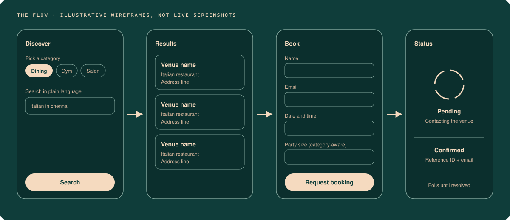

<div align="center">


# Edit Theory Concierge

**One booking flow for every local business.**  
Search a venue, book it, watch the status resolve to a real confirmation email.


[**Live demo**](https://edit-theory-concierge-s6ra.vercel.app) · [Backend case study](https://github.com/Samhita1008/edit-theory-agents/tree/main/6-edit-theory-concierge) · [Report an issue](../../issues)

</div>

---

## What it is

Restaurants, gyms, salons, parlours, travel agencies: one booking flow for all of them. A customer picks a category, searches in plain language ("italian in chennai"), sees a list of real venues, books in a couple of taps, and lands on a live status screen that resolves to a confirmation email.

This is not an internal tool. It is the customer-facing frontend for [Edit Theory](https://github.com/Samhita1008): something a business could hand to its own customers.

## The flow

<div align="center">

</div>

| Screen | What happens |
|---|---|
| **Discover** | Choose a category, search in plain language |
| **Results** | Real venues from OpenStreetMap, shown as cards with name and address |
| **Book** | A form that asks for different fields depending on the category |
| **Status** | Polls the backend until the booking is confirmed or declined |

> Wireframes above are illustrative. Swap in real screenshots or a short GIF once captured.

## What's live and what's simulated

Nothing here is quietly faked. Two pieces are built end to end but intentionally simulated in the public demo, and the UI says so too.

| Piece | In the public demo | When it goes live |
|---|---|---|
| Venue discovery | Free OpenStreetMap data (Nominatim + Overpass) | Google Places node is built and wired, inactive until an API key is supplied |
| Venue confirmation | Simulated: a timed random confirm or decline | WhatsApp Cloud API node is built and wired, inactive until a partner business has credentials and an approved message template |
| Booking log | **Live**: real Google Sheets rows | n/a |
| Confirmation email | **Live**: real Gmail send | n/a |
| Validation, status polling | **Live** | n/a |

Nothing about the customer-facing flow changes when either integration activates, only what happens behind the webhook calls.

## Architecture

```
React + Vite frontend
        │
        ├── VITE_WEBHOOK_DISCOVER ──► n8n: Groq extracts location → Nominatim → Overpass → results
        ├── VITE_WEBHOOK_BOOK     ──► n8n: validate → Sheets → respond → venue contact → email
        └── VITE_WEBHOOK_STATUS   ──► n8n: look up booking by ID → status
```

The full backend writeup, including the exact bugs hit while building it, is in the [backend case study](https://github.com/Samhita1008/edit-theory-agents/tree/main/6-edit-theory-concierge).

## Run it locally

```bash
npm install
npm run dev
```

Copy `.env.example` to `.env.local` and point the three variables at a running backend. Left unset, the app falls back to demo data so it always renders something reasonable.

```bash
VITE_WEBHOOK_DISCOVER=
VITE_WEBHOOK_BOOK=
VITE_WEBHOOK_STATUS=
```

## Deploy

Built with Vite and deploys cleanly to Vercel: root directory is the repo root, build command `npm run build`, output `dist`. Add the same three environment variables in the Vercel dashboard for a fully connected deployment, or leave them blank for an always-available public demo.

## Why this exists

Most automation work is invisible: a workflow humming in the background that only its owner ever sees. This one has a front door. Building it forced product decisions beyond the backend logic. What does a customer see when a search comes back empty? What should "pending" feel like while waiting on a reply? How do you tell people what's live and what's simulated in the interface itself, not only in a README nobody reads?

## What's next

- [ ] Onboard a real restaurant partner and switch on WhatsApp confirmation
- [ ] Activate Google Places discovery
- [ ] Real screenshots and a short demo GIF in this README

---

<div align="center">

Built by **Samhita** · [Edit Theory](https://github.com/Samhita1008)

</div>
